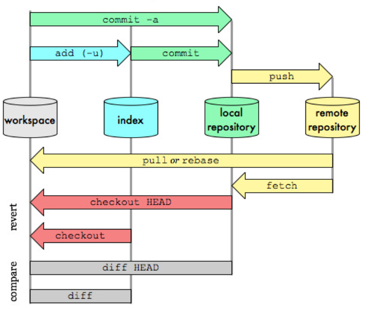

# Довідник команд Git

## Перше налаштування Git

### `config`
* `--system -l` — конфігурація для всіх користувачів (`c:/Program Files/Git/etc/gitconfig`)
* `--global -l` — конфігурація для користувача (`[user]/.gitconfig`)
* `--local -l` — конфігурація для репозиторію (`.git/config`)
* `--global user.name "..."` — ім'я користувача
* `--global user.email ...` — e-mail
* `user.name "..."` — ім'я користувача для проєкту
* `user.email ...` — e-mail для проєкту
* `--global alias.<shortname> '<command>'` — введення псевдоніму команді

---

## Отримання довідки

### `help`
* `<command>` — онлайн-довідка

### `<command> -h`
* коротка довідка

---

## Як працює Git

### `git workflow`
* Створіть repository (проєкт) за допомогою інструменту **New** на сайті GitHub
* Скопіюйте (`clone`) репозиторій на вашу локальну машину
* Додайте файл до свого локального репо та `commit` (збережіть) зміни
* `Push` ваші зміни до основної гілки віддаленого сховища
* Внесіть зміни у свій файл за допомогою інструмента хостингу git і зробіть `commit`
* `Pull` зміни на вашу локальну машину
* Створіть гілку (версію), внесіть зміни, зробіть `commit` змін
* Відкрийте `pull request` (запропонуйте зміни до головної гілки)
* Зробіть `merge` своєї гілки з головною гілкою

---

## Клонування репозиторію

### `clone`
* `https://github.com/<repo>` — копіювання існуючого GitHub репозиторію
* `<local path>` — копіювання з локального сховища
* `--single-branch` — клонувати лише одну гілку, на яку вказує `HEAD` або `--branch`
* `-b` — клонувати віддалену гілку замість `HEAD`
* `-o <new server name>` — змінює ім'я за замовчуванням `origin` на нове
* `--recurse-submodules` — автоматично ініціалізує та оновлює кожен підмодуль у репозиторії

---

## Створення репозиторію з існуючого каталогу

### `init`
* розпочинає використання Git із цим проєктом

---

## Відстеження нових файлів

### `add`
* `<file>` — розпочати відстеження нового файлу
* `-i` — інтерактивний режим
* `.` — відстежити всі файли поточної директорії

---

## Запис змін до репозиторію

### `commit`
* `-m "commit message"` — внести зміни та прокоментувати (для детального опису, не закриваючи подвійні лапки, ввести порожній рядок і далі ввести багаторядковий коментар, завершивши подвійними лапками)
* `<file>` — внести зміни до файлу
* `--amend` — викликає текстовий редактор для заміни попереднього коміту поточним індексом та перезаписує попередній коміт поточним індексом
* `-am "message"` — внести зміни з попереднім додаванням в індекс

---

## Опублікування змін

### `push`
* `<remote> <branch>` — надсилає гілку на віддалений репозиторій
* `<remote> <local branch>:<remote branch>` — надсилає локальну гілку на віддалену з іншим іменем
* `--all, --branches` — надсилає всі гілки на віддалений репозиторій
* `<remote_name> -d, --delete <remote_branch-name>` — видалення віддалених гілок
* `origin <tagname>` — надсилає тег на віддалений репозиторій
* `origin --tags` — надсилає всі теги на віддалений репозиторій
* `origin --delete <tagname>` — видаляє тег з віддаленого репозиторію
* `origin --delete <branch name>` — видаляє віддалену гілку
* `-u origin <branch>` — додає віддалену гілку, що відстежується
* `-u origin <branch1>:<branch2>` — надсилає зміни з локальної гілки 1 на віддалену гілку 2
* `-f <origin> <branch>` — замінює гілку на сервері комітом, який не є її нащадком

---

## Перенесення змін на локальний репозиторій

### `fetch`
* `origin` — оновлює локальні посилання на дані віддаленого сховища

### `pull`
* отримує та об’єднує віддалену гілку з поточною гілкою
* `<url> <branch>` — зливає зміни з віддаленої гілки без необхідності додавати віддалене сховище; одночасно виконує `fetch`, `checkout`, `merge`

---

## Створення нової гілки (версії)

### `branch`
* виводить список локальних гілок
* `<branch name>` — створює новий `HEAD` на поточний коміт, але не переключається на нього
* `-d <branch name>` — видаляє гілку
* `-v` — виводить останній коміт з кожної гілки
* `--merged` — виводить гілки, вже об’єднані з поточною
* `--no-merged` — виводить гілки, які містять ще не об’єднані дані
* `-D <branch name>` — видаляє гілку, що містить не об'єднані дані
* `--all` — виводить локальні та віддалені гілки, що відстежуються
* `-u <remote>/<branch name>` — змінює прив'язку до віддаленої гілки
* `-vv` — виводить інформацію про відстежувані гілки та відставання у відстеженні
* `<newbranch> <oldbranch2>` — відгалужує нову гілку від існуючої без переключення

---

## Перевірка стану файлів

### Статус файлів
* **Untracked** — неконтрольований Git
* **Unmodified** — після виконання `commit`
* **Modified** — відредагований
* **Staged** — індексований для наступного `commit`

### `status`
* відображає стан файлів та конфлікти злиття
* `-s` — відображає скорочено стан індексу і робочої директорії
* `-b master` — відображає стан гілки `master`
* `--ignored` — відображає стан ігнорованих файлів

### `diff`
* показує неіндексовані зміни (між робочим деревом та індексом)
* `--staged` — зміни між індексом і останнім комітом
* `HEAD` — зміни між робочим деревом та останнім комітом
* `AUTO_MERGE` — зміни в робочому дереві після вирішення текстових конфліктів
* `<branch1> <branch2>` — зміни між гілками
* `--check` — перевірка помилок із кінцевими пробільними символами
* `--name-only` — показує лише імена файлів, які відрізняються
* `--name-status` — показує імена файлів, які відрізняються, з індикацією статусу змін (`A`, `M`, `D`)
* `<commit> <commit>` — показує зміни між двома комітами
* `<commit> <file>` — показує зміни у файлі між комітом та робочим деревом

---

## Ігнорування файлів

### `.gitignore`
* `#` — коментар
* `/` — після імені вказує на каталог
* `!` — на початку шаблону заперечує його
* `*` — відповідає нулю або більше символів
* `[abc]` — відповідає будь-якому символу в дужках
* `?` — відповідає одному символу
* `a/**/z` — відповідає вкладеним директоріям

---

## Видалення файлів

### `rm`
* `<file>` — видаляє файл з робочого дерева та індексує видалення в наступному коміті
* `--cached <file>` — видаляє файл лише з індексу; робочі файли залишаються та не контролюються
* `-f` — видалення файлів, вже доданих до індексу
* `\*` — розкриття шаблону

---

## Переміщення та перейменування файлів

### `mv`
* `<file_from> <file_to>` — перейменовує файл та додає до індексу
* `mv <file> ... <directory>` — переміщення файлу в директорію

---

## Перегляд історії комітів

### `log`
* перераховує коміти у зворотному хронологічному порядку
* `-p, --patch` — показати зміни, внесені кожним комітом
* `-<n>` — показати `n` останніх комітів
* `--oneline` — показує короткий хеш комітів в одному рядку
* `--pretty=`
  * `oneline` — друкує кожен коміт в одному рядку
  * `format:`
    * `%h` — скорочений хеш коміту
    * `%an` — ім’я автора
    * `%ae` — поштова адреса автора
    * `%s` — тема
* `--graph` — показує історію ваших гілок та зливань
* `--since=2.weeks` — список комітів за останні два тижні
* `--until=2.weeks` — список комітів до останніх двох тижнів
* `-- <path/to/file>` — журнал комітів для файлів
* `<branch>..origin/<branch>` — надає зміни у віддаленій гілці відносно локальної
* `--no-merges <branch1>..<branch2>` — відображає коміти другої гілки, яких немає в першій
* `<branch> --not master` — відображає коміти, які є в `branch`, проте яких немає в `master`
* `<branch1>...<branch2>` — відображає коміти гілок, яких немає в іншій
* `-S <line>` — показати коміти, що змінили входження `line`
* `-L '/<start>/,<end>:<path>'` — показує коміти, в яких змінено рядки, що починаються зі `start` та закінчуються на `end` у файлі `path`
* `-p -- <file-path>` — показує зміни вказаного файлу

---

## Відмова від змін

### `reset`
* `<file>` — деіндексує файл, повертаючи його з `HEAD` до індексу
* `--soft HEAD~` — скасовує останню команду `git commit`, повертаючи `HEAD` на попередній коміт без зміни індексу та робочої директорії
* `--soft HEAD~n` — скасовує `n` останніх комітів, повертаючи `HEAD` на `n` комітів без зміни індексу та робочої директорії
* `--mixed HEAD~` — скасовує останні команди `git commit` та `git add`, повертаючи `HEAD` на попередній коміт зі зміною індексу та без зміни робочої директорії
* `--hard HEAD~` — скасовує останні команди `git commit` та `git add`, повертаючи `HEAD` на попередній коміт зі зміною індексу та робочої директорії; також скасовує небажаний коміт зливання у локальному репозиторії
* `<commit> <file>` — повертає в індекс версію файлу із заданого коміту
* `<branch name>` — переміщує гілку на поточний `HEAD`
* `<commit>` — повертає версію `HEAD` та індекс із заданого коміту

### `revert`
* `-m 1 HEAD` — скасовує всі зміни з існуючого коміту

### `restore`
* замінює файли в робочій директорії
* `<file>` — відновлює робочий файл з індексу
* `--staged <file>` — відновлює файл в індексі з `HEAD`
* `--staged --worktree <file>` — відновлює робочий файл та індекс з `HEAD`
* `--source=<tree>` — вказує джерело для відновлення

### `checkout`
* `<branch name>` — переміщує `HEAD` на існуючу гілку зі зміною індексу та робочих файлів, а якщо такої гілки не існує, то створює локальну копію віддаленої гілки
* `-- <file>` — скасовує зміни в робочому каталозі
* `<tagname>` — виводить версію файлу, помічену тегом
* `-b <branch name>` — створює нову гілку та переходить на неї
* `-b <new branch> <remote>/<branch>` — створює локальну копію віддаленої гілки, переходить та відстежує її, з можливістю зміни імені
* `--track <remote>/<branch>` — скорочена версія створення копії та відстеження віддаленої гілки
* `<commit>` — повертає версію `HEAD`, індекс та робочу директорію із заданого коміту

---

## Взаємодія з віддаленими сховищами

### `remote`
* `-v` — показує URL-адреси віддаленого сервера з доступом для читання та запису
* `add <shortname> <url>` — додає нове віддалене сховище Git
* `show origin` — показує URL-адресу віддаленого сховища та гілки відстеження
* `rename <old name> <new name>` — змінює ім'я віддаленого сховища
* `remove <name>` — видаляє посилання на віддалене сховище

---

## Встановлення тегів

### `tag`
* виводить список тегів
* `-l <pattern>` — виводить список тегів за шаблоном
* `show <tag version>` — виводить тег разом із комітом, який було позначено тегом
* `<tagname>` — створює легкий тег
* `-a <tagname> -m "tag message"` — створює анотований тег
* `-a <tagname> <commit checksum>` — створює тег до існуючого коміту
* `-d <tagname>` — видаляє тег з локального репозиторію

---

## Зливання гілок

### `merge`
* `<branch name>` — зливає вказану гілку з поточною
* `<remote>/<remote branch>` — зливає віддалену гілку з поточною
* `--abort` — повертає до стану на початку зливання
* `-Xours` — обирає поточну гілку за наявності конфліктів злиття
* `-Xtheirs <branch>` — обирає зовнішню гілку за наявності конфліктів злиття
* `-s ours <branch>` — уявне злиття без застосування зовнішньої гілки

---

## Перебазовування

### `rebase`
* `<branch>` — перебазує поточну гілку на вказану, роблячи лінійну історію комітів
* `--onto <branch1> <branch2> <branch3>` — перебазує коміти гілки 3, які відгалужені від гілки 2, на гілку 1
* `<branch1> <branch2>` — перебазує гілку 2 на гілку 1

---

## Сервер Git

### Локальний протокол
* `clone <path>` — клонування локального сховища
* `remote add <repo> <path>` — додавання локального сховища

### SSH ключ
* `ssh-keygen -t rsa -b 4096 -C "lsv@kotris.ua"` — команда генерації ключа
* `user/.ssh` — місцезнаходження ключа
* `id_name, id_name.pub` — приватний та публічний ключ
* `ssh-keygen` — команда генерації ключів

### Посилання
* `<number>` — посилання на Pull Request чи на Issue
* `<user name#number>` — посилання на користувача
* `<user name/repo#number>` — посилання на інше сховище

---

## Запит на злиття змін

### `request-pull`
* `origin/master <repo>` — запит супроводжувачу проєкту на злиття змін

---

## Посилання змін електронною поштою

### `format-patch`
* `-M origin/master` — генерує перелік перейменованих файлів у форматі mbox для відправки електронною поштою

### `send-email`
* `<pattern>` — надсилає латки на електронну адресу, вказану в `~/.gitconfig`

### `apply`
* `<patch path>` — змінює файли у вашій робочій директорії на латку з електронної пошти
* `--check <patch>` — перевіряє, чи латка застосована чисто

---

## Стек незавершених змін

### `stash`
* зберігає зміни в стеку
* `list` — відображає збережені зміни
* `apply` — використання щойно збережених змін
  * `stash@{2}` — використання однієї з попередніх змін
  * `--index` — використання змін з одночасним індексуванням
* `drop` — видалення змін зі стеку
* `pop` — використання ховання з одночасним видаленням зі стеку
* `--keep-index` — збереження змін з одночасним індексуванням
* `-u` — зберегти також зміни несупроводжуваних файлів
* `--patch` — інтерактивний вибір збереження
* `branch <branch name>` — створює нову гілку із назвою коміту, з якого ви зробили збереження, та видаляє збереження
* `--all` — видаляє всі зміни, проте зберігає їх у стеку

---

## Очищення робочої директорії

### `clean`
* позбавляє змін у робочій директорії та видаляє файли, які не супроводжуються, але відсутні в `.gitignore`
* `-f -d` — лише видаляє файли, які не супроводжуються
* `-d -n` — нічого не видаляє та показує, що можна видалити
* `-d -x` — видаляє також файли, що вказані в `.gitignore`
* `-x -i` — інтерактивне видалення

---

## Пошук

### `grep`
* шукає в будь-якому дереві коміту або робочій теці заданий рядок
* `-n` — вивести номери рядків, у яких є збіги
* `-c` — показує, в яких файлах знайдено рядок та скільки таких рядків
* `-p` — показує контекст навколо шуканого рядка
* `--and` — шукає декілька збігів, що мають бути в одному рядку

---

## Визначення дати та автора змін

### `blame`
* `-L <start>,<end> <path>` — показує, який коміт востаннє редагував кожен рядок будь-якого файлу

---

## Додавання проєкту до іншого

### `submodule`
* `add <url>` — додає існуючий репозиторій Git як підмодуль у директорію з назвою репозиторію
* `init` — ініціалізація підмодуля в основному репозиторії
* `update` — отримує дані з проєкту підмодуля
* `update --remote <repo>` — перейде до підмодуля та отримає й оновить зміни